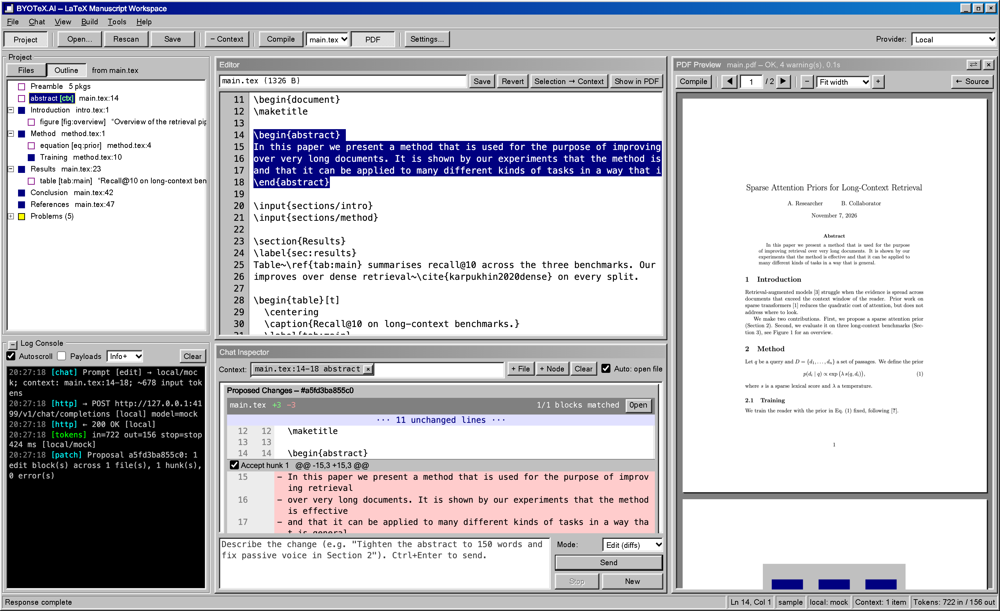
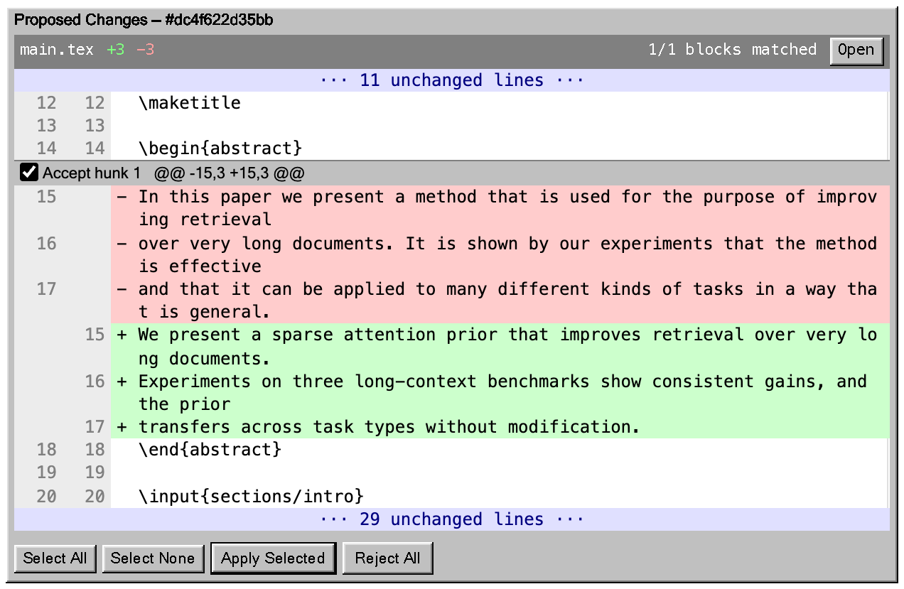
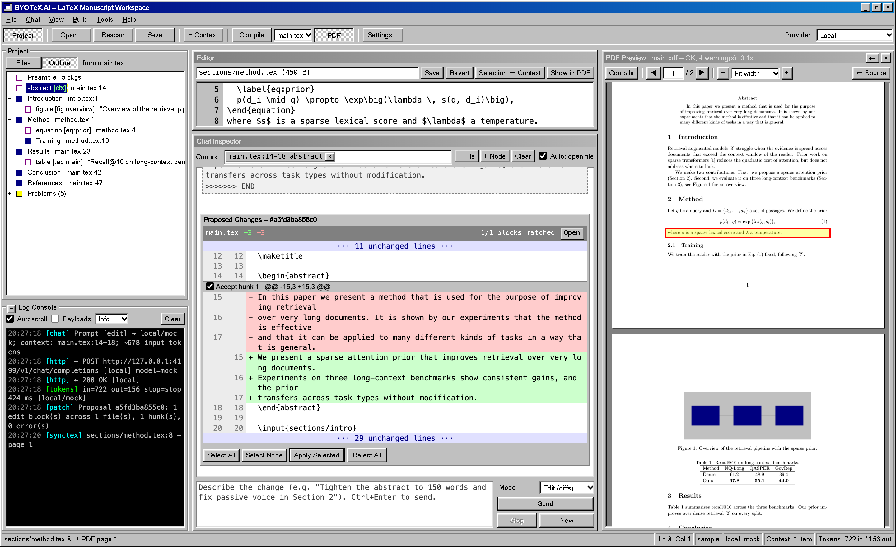

# BYOTeX.AI

**Bring your own AI to LaTeX.** BYOTeX.AI is a local LaTeX manuscript workspace, styled as a Windows 98 utility. You ask for changes in plain English, for example "tighten the abstract" or "fix the passive voice in Section 2". The model proposes edits as a **line-by-line diff**, and you accept or reject each change before anything is written to disk.



<sub>The screenshots use the bundled offline mock model (`npm run mock-llm`), so no API key was involved.</sub>

## Features

- **Any AI you like:**
  - your own key for **Anthropic**, **OpenAI**, **Google Gemini** or **OpenRouter**;
  - a **local model** (Ollama, LM Studio, llama.cpp, vLLM);
  - **OpenCode's free models**, with no key at all.
- **Reviewable edits:** every AI change arrives as a diff with an *Accept* checkbox per hunk. Files are backed up before every write, and a write is refused if the file changed on disk in the meantime.
- **Compile and preview:** `latexmk` with pdfLaTeX, XeLaTeX or LuaLaTeX, and a PDF.js preview that keeps your place when you recompile.
- **SyncTeX in both directions:** *Show in PDF* jumps from the cursor to the PDF; double-click the PDF to jump to the source line.
- **Understands your project:**
  - a document outline that follows `\input` / `\include`;
  - checks for undefined citations and labels and for missing figures;
  - errors from `latexmk` shown with their file and line.
- **Private by design:**
  - runs only on your own computer (`127.0.0.1`);
  - API keys are encrypted on disk (AES-256-GCM) and never sent back to the browser;
  - the AI can only *suggest* edits; it never writes files itself.
- **Helps you get LaTeX:** it detects MacTeX, TeX Live, MiKTeX and TinyTeX, or installs TinyTeX for you without admin rights.
- **Retro and adjustable:** layouts with chat in a tab, below the editor or beside it; the PDF on the left or right; a document outline; and choices for font, size and colour.

| Diff review | Source ↔ PDF (SyncTeX) |
|---|---|
|  |  |

## Quick start

Requirements: [Node.js](https://nodejs.org) 18.17 or newer. For compiling, a TeX distribution with `latexmk` is also needed; the app can install TinyTeX for you.

```bash
git clone https://github.com/sadimanna/byotex-ai.git
cd byotex-ai
npm install
npm start                 # then open http://127.0.0.1:4198/
```

Then:
1. Open **Settings** and choose a provider:
   - paste an API key; or
   - choose **Local endpoint** for Ollama or LM Studio; or
   - choose **OpenCode (free models, no key)**.
2. Use **File → Open Workspace…** to point the app at your LaTeX project folder. A sample paper is included in `sample/`.

**Status:** an early release, tested on macOS. Windows and Linux are supported in the code but have not been tested yet; bug reports are very welcome.

> **Privacy note on free models:** OpenCode says prompts sent to its *free* models may be stored and used to improve them. Your manuscript text is part of every request, so use your own key or a local model for unpublished or confidential work.

## Using the app

| Pane | What it does |
|---|---|
| **Project** tree (top left) | Folders, `.tex`/`.bib`/figure files, and each `.tex` file's outline: preamble, sections, figures/tables/equations. Also a **Problems** node. Click to open or jump to a node; double-click to add it to the chat context. |
| **Log Console** (bottom left) | Live SSE stream of backend events. It shows outgoing request payloads with keys redacted (tick *Payloads*), token counts, patch results and file writes. |
| **Editor** tab | Plain-text editor with a line-number gutter. Save with Ctrl+S; saves are hash-checked against the copy on disk. Figures open as image previews. |
| **Chat Inspector** tab | Context chips, a streaming transcript, and reviewable **Proposed Changes** boxes with a per-hunk *Accept* checkbox, *Apply Selected* and *Reject All*. |

## Layout, compiling and fonts

- **View → Chat:** keep the Chat Inspector as a tab next to the Editor, put it *below* the Editor, or put it *to the right* of it. In the two split layouts you can see the file while you type a prompt. Drag the divider to resize.
- **Build → Compile PDF** (Ctrl/Cmd+Shift+B, or the **Compile** toolbar button) runs `latexmk` with pdfLaTeX, XeLaTeX or LuaLaTeX on the main file picked in the toolbar. Output goes to `<project>/.byotex-build/`. TeX errors and warnings appear under **Problems** with their source file and line (click one to jump there). Set the log filter to *All* to see the raw TeX output. *Compile on Save / Apply* rebuilds after every save and every applied patch.
- **PDF preview** uses PDF.js, served locally from `node_modules/pdfjs-dist` so no CDN is needed. It opens on the left or right of the editor (View menu, or the toolbar's **PDF** button; ⇄ swaps sides). Drag its divider to resize it. A recompile keeps your scroll position. The zoom options are fit width, fit page, fixed steps, or Ctrl/Cmd + mouse wheel.
- **SyncTeX:** **Show in PDF** (in the editor header, or Ctrl/Cmd+Shift+J) highlights the cursor's line in the PDF. **Double-click** anywhere in the PDF to open the source file at that line.
- **Project pane:** hide or show it with Ctrl/Cmd+B or the **Project** toolbar button. The − button on the Log Console collapses only the log.
- **View → Fonts & Colors…** sets the size and text colour of the editor, chat/diffs and console separately, plus the colour of menus/panes and secondary text. All text defaults to black, except the console, which keeps light text on black; *Light Console* switches it to black on white. Ctrl/Cmd+Shift+. and , change the editor size. Layout, font and colour choices are remembered in the browser.
- **Stale server warning:** if the backend files on disk are newer than the running server, the UI tells you to restart it. During development, `npm run dev` restarts the server automatically when `server/` changes.

- **LaTeX installation** (Build → LaTeX Installation…, or Settings → LaTeX Installation): set the folder that contains `latexmk`/`pdflatex` if it isn't found automatically. MacTeX, TeX Live, MiKTeX and TinyTeX locations are checked by default. If no LaTeX is found, Compile offers three choices: point to a folder; install **TinyTeX** from inside the app (it runs the official installer from yihui.org into your home folder, needs no admin password, and shows its progress in the Log Console); or copy a command for a full distribution (MacTeX via Homebrew, MiKTeX via winget, TeX Live via apt/dnf).

Compile safety: `latexmk -norc` stops a project's `.latexmkrc` (which is Perl code) from running, and `shell_escape=f` turns off `\write18`.

## Missing LaTeX packages (`.sty` not found)

If your document uses a package your LaTeX doesn't have, compiling fails and **Problems** shows the error with its file and line, for example:

```
main.tex:5: LaTeX Error: File `booktabs.sty' not found.
```

BYOTeX.AI doesn't install packages for you yet. How to add one depends on your LaTeX:

| Your LaTeX | What to do |
|---|---|
| **TinyTeX** (including the one the app installs) | `tlmgr install booktabs`, with no admin password needed, because TinyTeX lives in your home folder. `tlmgr` comes with TinyTeX. |
| **MacTeX** (full) | Usually nothing: the full version already includes almost every package. |
| **BasicTeX**, or TeX Live installed system-wide | `sudo tlmgr install booktabs` (needs your admin password). |
| **TeX Live from Linux packages** | Install the collection that contains it, e.g. `sudo apt install texlive-latex-extra` (Debian/Ubuntu) or `sudo dnf install 'tex(booktabs.sty)'` (Fedora). |
| **MiKTeX** (Windows) | Usually nothing: MiKTeX installs missing packages during the compile, or asks first, depending on its settings. |

**The package name isn't always the file name.** `tikz.sty` comes from the `pgf` package, and `algorithmic.sty` from `algorithms`. To find the right package for a missing file:

```bash
tlmgr search --global --file "/tikz.sty"
```

Then run `tlmgr install <package>` and click **Compile** again.

If `tlmgr` says **"Local TeX Live (2025) is older than remote repository (2026)"**, a new TeX Live edition has come out since yours was installed, and the old `tlmgr` can't fetch packages from it. You have two options:
- **Update your TeX** to the current edition: reinstall TinyTeX from the app, or get the new BasicTeX/MacTeX.
- **Keep it, and point `tlmgr` at the frozen archive for your year** (change `2025` to your version; prefix with `sudo` for BasicTeX or a system TeX Live):

  ```bash
  tlmgr option repository https://ftp.math.utah.edu/pub/tex/historic/systems/texlive/2025/tlnet-final
  ```

  After that, `tlmgr search` and `tlmgr install` work again. That edition no longer receives updates, but every package from that year is available.

If the terminal says `tlmgr: command not found`, it isn't on your PATH. Use the folder shown in **Build → LaTeX Installation…**, for example `~/Library/TinyTeX/bin/universal-darwin/tlmgr install booktabs` on macOS, or `~/.TinyTeX/bin/x86_64-linux/tlmgr …` on Linux.

## Backend modules (`server/`)

- `index.js`: Express gateway. It binds to `127.0.0.1` only, rejects unexpected `Host` headers (blocks DNS rebinding), and requires a per-launch session token on every `/api` call.
- `store.js`: settings and API keys sealed with **AES-256-GCM** in `~/.byotex-ai/settings.enc.json`. The key is a random master key in `~/.byotex-ai/master.key` (chmod 600), or one derived with scrypt from `BYOTEX_PASSPHRASE` if that is set. Keys are never sent back to the UI, which only gets a hint such as `sk-a…6789`.
- `parser.js` / `workspace.js` (Module 1): directory scan, `.tex` structure nodes (sections with line ranges, environments, labels, refs, cites, includes, graphics) and `.bib` entries. Cross-checks report undefined citations or labels and missing figures, includes and bibliographies. All paths are confined to the workspace root (symlinks included), and writes are limited to `.tex .bib .sty .cls .txt .ltx`.
- `prompt.js` + `llm.js` (Module 2): wraps the request with the project outline, the targeted files or line ranges, and the available citation keys. Responses stream from **Anthropic** (Messages API), **OpenAI**, **Google Gemini** (via its OpenAI-compatible endpoint), **OpenRouter**, or any **OpenAI-compatible local endpoint** (Ollama, LM Studio, llama.cpp, vLLM).
- `patch.js` + `diff.js` (Module 3): parses the model's `<<<<<<< EDIT path … ======= … >>>>>>> END` blocks. Each block is matched exactly first, then with whitespace-tolerant matching, and ambiguous or missing matches are reported. It then builds an LCS line diff split into hunks. Only the accepted hunks are written, after checking that the file has not changed on disk since the proposal. Each write first backs up the file to `<project>/.byotex-backups/<timestamp>/` and then replaces it atomically.
- `opencode.js`: the OpenCode provider (private server, tool-less sessions, event streaming, free-limit detection, npm install).
- `texenv.js`: finds the TeX tools (a configured folder first, then PATH, then the standard install locations) and runs the TinyTeX installer.
- `compile.js`: the latexmk runner and the `.log` parser. It follows TeX's open-file stack so each warning is attributed to the file it came from.
- `logger.js` (Module 4): the log bus behind the console.

## Free models through OpenCode (no API key)

Choose **OpenCode (free models, no key)** as the provider. BYOTeX.AI uses a locally installed [OpenCode](https://opencode.ai) (MIT-licensed). If OpenCode is missing, **Settings → OpenCode → Install...** runs `npm install opencode-ai` into `~/.byotex-ai/opencode`, with no admin rights needed. Then use **List...** to pick one of OpenCode's free models.

- **How it's wired:** BYOTeX.AI starts its own private `opencode serve`. It listens on loopback only, on a random port, behind a random password; it runs with `--pure` (no third-party plugins) and from an empty sandbox folder. BYOTeX.AI drives it through OpenCode's documented HTTP API, with **every OpenCode tool switched off**, so the model can only propose edits as text and the diff review stays the only way files change.
- **Limits:** free use is rate-limited by OpenCode. When the limit is reached, BYOTeX.AI shows the reset time instead of waiting.
- **Privacy:** OpenCode states that prompts sent to its *free* models may be stored and used to improve those models. Your manuscript text is part of each request, so don't use free models for confidential or unpublished work you don't want shared.

## Trying it without an API key

```
npm run mock-llm
```

Then go to **Settings → Local endpoint**, set the Base URL to `http://127.0.0.1:4199/v1` and the model to `mock`, and make it the active provider. The mock streams back a realistic EDIT block. For example, it rewrites the abstract of `sample/main.tex`.

## Environment variables

`PORT` (default 4198), `BYOTEX_DATA_DIR` (default `~/.byotex-ai`), `BYOTEX_PASSPHRASE` (derive the encryption key from a passphrase instead of the key file), `BYOTEX_QUIET=1` (silence stdout logging).

## License

[MIT](LICENSE) © 2026 Siladittya Manna
